<p align="center">
  
</p>

<p align="center">
  <a href="https://www.anypayx.com"></a>
  <a href="https://www.npmjs.com/package/@anypay/prices-client"></a>
  <a href="https://github.com/anypay/prices-client-ts"></a>
  <a href="https://www.typescriptlang.org/"></a>
</p>

<p align="center">
  <a href="https://www.anypayx.com">Website</a> ·
  <a href="https://www.anypayx.com/docs">Docs</a> ·
  <a href="https://api.anypayx.com/api">API</a> ·
  <a href="https://www.anypayx.com/prices">Prices</a> ·
  <a href="https://github.com/anypay">GitHub</a>
</p>

---

## What It Is & Purpose

**Anypay Prices Client** is the official TypeScript SDK for the Anypay Prices API. It provides real-time cryptocurrency and stablecoin price feeds, conversion rates, and market data through both HTTP REST endpoints and WebSocket streams. Built for browser and Node.js environments, it delivers reliable, up-to-the-second quotes for Bitcoin, Ethereum, and stablecoins (USDC, USDT, RLUSD, NUSD) across exchanges.

Whether you're building a merchant dashboard, a trading interface, a payment calculator, or a portfolio tracker, this SDK eliminates the complexity of exchange polling, WebSocket reconnection, and rate normalization. It wraps the Prices API in a clean, typed interface so you can focus on your application logic, not on price feed infrastructure.

The SDK is production-ready, used by Anypay's own merchant dashboard and checkout flows, and maintained in lockstep with the Prices API's evolving feature set.

## Why Use It

**Reliable price data for crypto payment applications.** When a merchant quotes a customer "0.00032 BTC for $12 USD," that conversion must be accurate, fresh, and available. This SDK handles that entire lifecycle — initial fetch, continuous updates, reconnection on network failure, and clean typed interfaces for every quote.

**Who it's for:**

- **Merchants and payment integrators** who need live BTC/ETH/stablecoin rates for point-of-sale systems, invoices, or checkout flows.
- **Developers building dashboards** that display current portfolio value, conversion rates, or market trends.
- **Applications requiring instant conversion quotes** without maintaining exchange API credentials or handling rate-limiting, caching, and fallback logic.

**Where it fits:**

The Prices Client sits between your application and the Anypay Prices API, which aggregates live quotes from multiple exchanges and normalizes them into a single, stable feed. It is a dependency of Anypay's merchant dashboard (`anypayx.com`), the web3-checkout UI, and internal settlement calculators. When your app calls `client.listPrices()`, it receives Anypay's vetted, rate-limited, deduplicated market data — no raw exchange SDKs required.

## How It Works

<p align="center">
  
</p>

The SDK operates in four stages:

1. **Your App** imports `@anypay/prices-client` and calls `createClient()` with optional configuration (custom API URLs, auth tokens).
2. **prices-client-ts** establishes either an HTTP connection (for one-shot price fetches) or a WebSocket connection (for continuous live updates) to the Anypay Prices API.
3. **Prices API** responds with current quotes aggregated from exchanges, normalized to USD or other base currencies, and timestamped.
4. **Live Quotes** flow back to your application via typed events (`price/updated`) or promise-resolved API responses (`listPrices()`, `convertPrice()`).

**WebSocket mode** (`subscribeToPricesUpdates()`) opens a persistent connection and emits `price/updated` events whenever a quote changes. The SDK handles reconnection automatically if the connection drops. **HTTP mode** (`listPrices()`, `getPrice()`, `convertPrice()`) is for point-in-time queries: grab the latest rate, convert an amount, and move on. Both modes support optional bearer-token authentication for access-controlled deployments.

The SDK is stateless beyond the WebSocket connection; it doesn't cache prices locally or buffer conversions. Every call hits the Prices API's live feed.

## Quickstart / How to Use It

### Installation

Install via npm:

```bash
npm install @anypay/prices-client
```

Or via yarn:

```bash
yarn add @anypay/prices-client
```

### Create a Client

```typescript
import { createClient } from '@anypay/prices-client';

const client = createClient({
  http_api_url: 'https://prices.anypayx.com',       // Optional; defaults to production
  websocket_api_url: 'wss://prices.anypayx.com',    // Optional; defaults to production
  token: 'your_bearer_token_here'                   // Optional; for authenticated endpoints
});
```

### Subscribe to Real-Time Price Updates (WebSocket)

```typescript
client.subscribeToPricesUpdates();

client.on('price/updated', (event) => {
  console.log('Price updated:', event.payload);
  // { base: 'USD', quote: 'BTC', value: 0.000032, source: 'coinbase', updated_at: '2026-11-27T...' }
});

client.on('websocket.open', () => {
  console.log('WebSocket connected');
});

client.on('websocket.error', (err) => {
  console.error('WebSocket error:', err);
});
```

To unsubscribe:

```typescript
client.unsubscribeFromPricesUpdates();
```

### Fetch Current Prices (HTTP)

```typescript
const prices = await client.listPrices();
console.log(prices);
// [{ base: 'USD', quote: 'BTC', value: 0.000032 }, ...]
```

### Get a Specific Price

```typescript
const price = await client.getPrice({
  base: 'USD',
  quote: 'BTC',
  source: 'coinbase'  // Optional; omit for Anypay's default aggregated rate
});
console.log(price);
// { base: 'USD', quote: 'BTC', value: 0.000032 }
```

### Convert Currency Amounts

```typescript
const conversion = await client.convertPrice({
  base: 'USD',
  value: 1000,
  quote: 'BTC'
});
console.log(conversion);
// {
//   base: { currency: 'USD', value: 1000 },
//   quote: { currency: 'BTC', value: 0.032 },
//   timestamp: Date
// }
```

### Run Tests

```bash
npm run test
```

The test suite uses Jest and is located in `src/`.

## Next Moves for Growth

1. **Add CI/CD and automated releases:** The repo currently builds with `webpack` and runs tests with `jest`, but lacks GitHub Actions for CI or automated npm publishing. Wire a CI workflow (`npm test`, `npm run build`) and semantic-release or a manual publish step so every merge to `main` can ship a new version automatically.

2. **Improve error handling and retry logic:** The WebSocket reconnection logic is basic (1-second fixed delay). Consider exponential backoff, max retry limits, and an `on('reconnecting')` event so applications can display "reconnecting" UI states. HTTP calls via axios have no retry wrapper; a failed `listPrices()` call returns raw axios errors. Wrap them in try/catch with meaningful error messages or a `PricesClientError` class.

3. **Document authentication and environment variables:** The `token` parameter is optional and undocumented. Add a section to this README explaining when auth is required (private deployments? rate-limited production?), how to obtain a token, and whether `.env` patterns (e.g., `ANYPAY_PRICES_TOKEN`) are recommended.

4. **Publish TypeScript source maps:** `dist/` currently ships `.js` and `.d.ts` files, but no `.js.map` for debugging. Enable `sourceMap: true` in `tsconfig.json` and include maps in the npm package so developers can step through SDK code in their debuggers.

5. **Expand test coverage:** `src/test_client.ts` is a manual smoke test, not a Jest suite. Add unit tests for `listPrices()`, `convertPrice()`, WebSocket reconnection, and event emission. Mock axios and ws to avoid hitting the live API in CI.

## Anypay Ecosystem & License

**Anypay Prices Client** is part of [Anypay](https://www.anypayx.com) — Bitcoin & Stablecoin payments for business. Merchants and developers use Anypay to accept BTC, ETH, and stablecoins such as USDC, USDT, RLUSD, and NUSD through invoices, APIs, SDKs, webhooks, WooCommerce, and mobile POS.

| Project | Role |
| --- | --- |
| [anypay](https://github.com/anypay/anypay) | Invoice & payments platform / API (`@anypay/server`) |
| [anypay-sdk](https://github.com/anypay/anypay-sdk) | TypeScript SDK for browser & Node.js (`@anypay/client`) |
| [web3-checkout-vite](https://github.com/anypay/web3-checkout-vite) | Current checkout UI (`checkout.anypayx.com`) |
| [walletbot](https://github.com/anypay/walletbot) | Self-custody headless wallet (`@anypay/walletbot`) |

**Related to Prices Client:**

| Project | Role |
| --- | --- |
| [prices.anypayx.com](https://www.anypayx.com/prices) | Live Prices API endpoint & web UI |
| [anypayx.com](https://github.com/anypay/anypayx.com) | Merchant dashboard consuming this SDK for live rates |

**License:** This project is licensed under the **ISC License**. See the `LICENSE` file (or `package.json`) for details. ISC is a permissive license similar to MIT, allowing commercial use, modification, and redistribution.

---

<p align="center">
  <a href="https://www.anypayx.com"></a><br/>
  <sub>Bitcoin & Stablecoin Payments For Business · <a href="https://www.anypayx.com">anypayx.com</a> · <a href="https://x.com/xanypay">@xanypay</a></sub>
</p>
